## 1. 问题现象

- 线上 MySQL 的 `Prepared_stmt_count` 持续处于高位，接近 `max_prepared_stmt_count` 上限。
- 应用 JDBC URL 中没有显式配置 `useServerPrepStmts`。
- 初步怀疑：ShardingSphere 在内部把该参数默认置为 `true`。

## 2. 结论

**确认是 ShardingSphere-JDBC 5.1.1 的默认行为，不是 MySQL 驱动或连接池自行开启。**

ShardingSphere 在创建 Hikari 数据源时，会向 Hikari 的 `dataSourceProperties` 注入一批 MySQL 驱动参数，其中包含：

| 参数                    | ShardingSphere 5.1.1 默认值 |
| ----------------------- | --------------------------- |
| `useServerPrepStmts`    | `true`                      |
| `cachePrepStmts`        | `true`                      |
| `prepStmtCacheSize`     | `200000`                    |
| `prepStmtCacheSqlLimit` | `2048`                      |

这些参数不会写进 JDBC URL，因此只检查 URL 看不到它们；实际连接时 Hikari 会把 `dataSourceProperties` 合并到 `Driver.connect(url, properties)` 的 `properties` 中。

当前配置的 URL 没有 `useServerPrepStmts` 和 `cachePrepStmts`，所以这两个参数被自动注入并生效。

## 3. 排查过程

### 3.1 知识库与项目版本

JDK 8、Spring Boot 2.5、shardingsphere-jdbc-core-spring-boot-starter 5.1.1

### 3.2 线上配置确认

当前 Nacos 中的数据源配置形如：

```yaml
spring:
  shardingsphere:
    datasource:
      names: ds0
      ds0:
        type: com.zaxxer.hikari.HikariDataSource
        driver-class-name: com.mysql.cj.jdbc.Driver
        username: xxx
        password: xxx
        url: jdbc:mysql://x.x.x.x:xxx/xxx?characterEncoding=utf8&zeroDateTimeBehavior=convertToNull&useSSL=false&allowMultiQueries=true&useJDBCCompliantTimezoneShift=true&useLegacyDatetimeCode=false&serverTimezone=Asia/Shanghai
```

URL 中已有的 `zeroDateTimeBehavior`、`useSSL`、`serverTimezone` 不会被 ShardingSphere 的默认值覆盖；但 `useServerPrepStmts`、`cachePrepStmts`、`prepStmtCacheSize` 等缺失项会被补齐。

### 3.3 源码证据

org.apache.shardingsphere.infra.database.metadata.dialect.MySQLDataSourceMetaData#buildDefaultQueryProperties

```java
private void buildDefaultQueryProperties() {
    defaultQueryProperties.setProperty("useServerPrepStmts", Boolean.TRUE.toString());
    defaultQueryProperties.setProperty("cachePrepStmts", Boolean.TRUE.toString());
    defaultQueryProperties.setProperty("prepStmtCacheSize", "200000");
    defaultQueryProperties.setProperty("prepStmtCacheSqlLimit", "2048");
    defaultQueryProperties.setProperty("useLocalSessionState", Boolean.TRUE.toString());
    defaultQueryProperties.setProperty("rewriteBatchedStatements", Boolean.TRUE.toString());
    defaultQueryProperties.setProperty("cacheResultSetMetadata", Boolean.FALSE.toString());
    defaultQueryProperties.setProperty("cacheServerConfiguration", Boolean.TRUE.toString());
    defaultQueryProperties.setProperty("elideSetAutoCommits", Boolean.TRUE.toString());
    defaultQueryProperties.setProperty("maintainTimeStats", Boolean.FALSE.toString());
    defaultQueryProperties.setProperty("netTimeoutForStreamingResults", "0");
    defaultQueryProperties.setProperty("tinyInt1isBit", Boolean.FALSE.toString());
    defaultQueryProperties.setProperty("useSSL", Boolean.FALSE.toString());
    defaultQueryProperties.setProperty("serverTimezone", "UTC");
    defaultQueryProperties.setProperty("zeroDateTimeBehavior", "round");
}
```

调用链：

```mermaid
flowchart LR
    A["spring.shardingsphere.datasource.ds0"] --> B["DataSourceMapSetter#getDataSource"]
    B --> C["DataSourcePoolCreator#create"]
    C --> D["DataSourceReflection#addDefaultDataSourceProperties"]
    D --> E["MySQLDataSourceMetaData#getDefaultQueryProperties"]
    E --> F["HikariDataSource.dataSourceProperties"]
    F --> G["MySQL Connector/J"]
    G --> H["COM_STMT_PREPARE"]
```



关键源码位置：

- `shardingsphere-jdbc-spring-boot-starter-infra` 的 `DataSourceMapSetter#getDataSource`：读取 `spring.shardingsphere.datasource.*`，调用 `DataSourcePoolCreator.create`。
- `shardingsphere-infra-common` 的 `DataSourcePoolCreator#create`：识别到 `com.zaxxer.hikari.HikariDataSource` 后，调用 `DataSourceReflection#addDefaultDataSourceProperties`。
- `DataSourceReflection#addDefaultDataSourceProperties`：从 Hikari 的 `dataSourceProperties` 和 JDBC URL query 中判断参数是否已存在；不存在才补默认值。
- `HikariDataSourcePoolFieldMetaData#getJdbcUrlPropertiesFieldName`：返回 `dataSourceProperties`，所以默认值写入 Hikari 的数据源属性，而不是改写 `jdbcUrl`。

判断逻辑：

```java
if (!containsDefaultProperty(defaultPropertyKey, jdbcConnectionProps, queryProps)) {
    jdbcConnectionProps.setProperty(defaultPropertyKey, defaultPropertyValue);
}

private boolean containsDefaultProperty(String defaultPropertyKey, Properties targetDataSourceProps, Properties queryProps) {
    return targetDataSourceProps.containsKey(defaultPropertyKey) || queryProps.containsKey(defaultPropertyKey);
}
```

Hikari 的 `dataSourceProperties` 在 `HikariConfig` 构造时初始化为空 `Properties`，随后由 `DriverDataSource` 合并到驱动连接参数。因此这条注入路径在当前配置下必然生效。

### 3.4 为什么 URL 上看不到

ShardingSphere 注入的是 Hikari 的 `dataSourceProperties`，不是 URL 字符串：

```text
jdbcUrl  = jdbc:mysql://...（原样保留）
props    = { useServerPrepStmts=true, cachePrepStmts=true, ... }
最终连接 = Driver.connect(jdbcUrl, props)
```

所以只检查 Nacos 里的 `url` 会得出“没有开启服务端预处理”的错误结论。

## 4. 为什么会打到 max_prepared_stmt_count

`max_prepared_stmt_count` 是 MySQL 的**全局**限制，统计的是所有会话中同时存在的服务端 prepared statement 数量；prepared statement 与会话绑定，会话关闭时自动释放。MySQL 8.0 默认值约为 1.6 万。

当前链路的放大因素：

1. **服务端预处理开启**：`useServerPrepStmts=true` 后，每次 `PreparedStatement` 执行前都会向 MySQL 发送 `COM_STMT_PREPARE`，计入全局计数。
2. **连接级缓存巨大**：`cachePrepStmts=true` + `prepStmtCacheSize=200000` 表示单个连接最多缓存 20 万条 prepared statement，连接存活期间基本不淘汰。这个缓存上限远大于 MySQL 全局默认上限。
3. **分表改写放大 SQL 变体**：ShardingSphere 会把一条逻辑 SQL 改写为每条物理表一条 SQL。分片键范围查询会广播到全部分片。
4. **Hikari 长连接**：连接池中的连接长期存活，缓存不会主动释放；连接数越多，累计的服务端 prepared statement 越多。
5. **多实例共享同一 MySQL**：`max_prepared_stmt_count` 是 MySQL 实例级全局值，所有应用实例、所有连接池共同竞争同一个上限。

近似关系：

```text
全局 Prepared_stmt_count
  ≈ 所有应用实例 × 每实例连接数 × 每连接缓存的不同 SQL 数
```

当 `prepStmtCacheSize` 远大于全局上限时，单连接就可能在缓存淘汰前先把 MySQL 全局计数打满。

## 5. 修复方案

### 5.1 推荐：显式关闭服务端预处理

在 Nacos 的 `spring.shardingsphere.datasource.ds0.url` 末尾追加：

```yaml
url: "jdbc:mysql://x.x.x.x:xxx/xxx?characterEncoding=utf8&zeroDateTimeBehavior=convertToNull&useSSL=false&allowMultiQueries=true&useJDBCCompliantTimezoneShift=true&useLegacyDatetimeCode=false&serverTimezone=Asia/Shanghai&useServerPrepStmts=false&cachePrepStmts=false"
```

说明：

- `useServerPrepStmts=false`：不再创建服务端 prepared statement，直接消除 `max_prepared_stmt_count` 的增长来源。
- `cachePrepStmts=false`：避免 20 万条客户端语句缓存带来的额外内存占用。
- 显式 key 会被 `containsDefaultProperty` 命中，ShardingSphere 不会再覆盖。

如果希望保留客户端预编译缓存，可以只关闭服务端预处理：

```yaml
url: "...&useServerPrepStmts=false"
```

但此时 `cachePrepStmts=true`、`prepStmtCacheSize=200000` 仍会被注入，建议同时下调 `prepStmtCacheSize`，例如：

```yaml
url: "...&useServerPrepStmts=false&prepStmtCacheSize=1000"
```

### 5.2 备选：通过 Hikari dataSourceProperties 配置

```yaml
spring:
  shardingsphere:
    datasource:
      ds0:
        data-source-properties:
          useServerPrepStmts: "false"
          cachePrepStmts: "false"
```

内部 key 使用 camelCase 原样写法。该方式最终也会被 `DataSourcePoolCreator` 读取并写入 Hikari 的 `dataSourceProperties`。

### 5.3 发布注意

- 数据源在应用启动时创建，修改 Nacos 后需要**重启实例**；动态刷新不会重建 Hikari 连接池。
- 如果存在多个 `spring.shardingsphere.datasource.*` 数据源，需要对每个数据源都显式配置。
